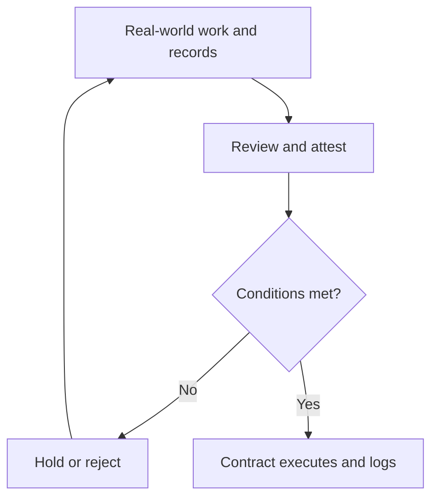

# Propertichain — Grand Park Roadmap v1.1

Updated: 8 Nov 2026. Proposed, acceptance-gated plan; no committed launch dates.

## Starting point

Start with existing, unsold developer-owned apartments and shophouses offered for sale, subject to owner consent and evidence checks. Grand Park is an independent case study; no Vingroup/Vinhomes, bank or other developer partnership is confirmed. Actual unsold inventory has not been provided.

Available: a public VI/EN site, sourced subdivision references and simulated walkthroughs. Not available: deployed testnet contracts, legally recognized token ownership, committed partners, interest forms or actual fundraising.

## Three-layer workflow

| Layer | Responsibility | Output |
|---|---|---|
| Real world | Owners, developers, banks, operators and appraisers | Actual work and original records |
| Attestation | Authorized parties review, sign and approve by property/version | Time-bound evidence and accountable signers |
| Contracts | Check conditions, supply, transfer rights and funded balances | Permitted actions and event logs |

Onchain recording does not prove input truth. Private documents remain offchain under access control; onchain records retain references, fingerprints, versions and appropriate attestations.

## Operating decision rules

1. Without verified existence, title, availability and developer consent: keep as candidate, do not enable issuance.
2. Reject attestations with wrong authority, expiry, property/version mismatch or revocation.
3. Lock issuance if rights or settlement prerequisites are incomplete; an operator click alone cannot authorize minting.
4. Do not distribute unfunded rent; record arrears and the correct period separately.
5. Hold stale or unsupported valuations; higher property value does not raise rental receipts.
6. Use only authorized pause/freeze powers on incidents, recording reasons; no autonomous seizure or unfreezing.
7. AI suggests, flags evidence gaps and explains; people attest and contracts enforce rules. AI cannot sign for banks, create guarantees or decide legal rights.

Standard decisions: HOLD / REJECT / READY / PAUSED, with reason, property, evidence, approver and rules version. An AI score cannot override mandatory conditions.

## Delivery phases

### R0 — Define the model and rules

In progress

Agree on a verifiable product before implementing contracts.

- **Real-world layer:** Define existing apartment and shophouse scope. Identify developers, operators, reviewers and banks to approach; none is assumed a partner.
- **Attestation layer:** Prepare document templates, authority matrix, any guarantee scope and rights-transfer prerequisites for professional review.
- **Contract layer:** Specify property identity, supply, rental vaults, permissions, freezes and tests; no token issuance.
- **Deliverables:** Bilingual site and walkthroughs exist; legal choices, actual partners and contracts remain open.
- **Exit gate:** Agree on MVP scope, accountable roles and A01–A11 acceptance criteria. Confirm hackathon pre-existing-code rules.
- **Proposed measures:** Maintain decided/open items; no unverified partner claims or actual inventory counts.

### R1 — Unsold developer inventory

Next priority

Select existing, developer-owned units offered for sale, with consent to the tokenization structure.

- **Real-world layer:** Request developer inventory by building/lot and unit ID. Proposed pilot target: 3–5 apartments/shophouses, leased or vacant.
- **Attestation layer:** Reconcile title, unsold primary status, handover, sale availability, encumbrances, leases, valuation and sale authority. Do not infer stock from advertising.
- **Contract layer:** Normalize the registry and state model using synthetic data; add real records only with permission and verification.
- **Deliverables:** Standard unit dossiers, evidence gaps, proposed sale fraction and funding route. Without a partner, use clearly marked fictional dossiers.
- **Exit gate:** Existing asset; verified owner; available for sale; authority and consent; restrictive obligations addressed under approved terms.
- **Proposed measures:** Every mandatory field is verified or explicitly missing; zero invented listings or duplicate issuance in the registry.

### R2 — Prove the workflow on testnet

Not implemented

Turn the walkthrough into testable contracts with simulated properties and test funds.

- **Real-world layer:** Product and engineering teams prepare role wallets, data scenarios and incident cases.
- **Attestation layer:** Simulate multi-party attestations bound to property, document version, permission, expiry and signer; reject expired or revoked attestations.
- **Contract layer:** Build registry, per-property tokens, vaults, issuance gates and permissions; test property isolation, mid-period transfers, pause/freeze and duplicate prevention.
- **Deliverables:** Source code, test results, testnet addresses and verifiable transactions; no unsupported audit claim.
- **Exit gate:** Pass A01–A11 plus attestation authority/expiry, duplicate issuance and direct-transfer-path checks; security review before wider testing.
- **Proposed measures:** No unresolved critical money/permission defects in tested scope; every test action is traceable.

### R3 — Reach and educate retail users

Parallel with R1–R2

Validate demand and product understanding before enabling actual purchases.

- **Real-world layer:** Use the website, Binance Square, X, Zalo/Facebook, video and broker/community demos. Invite product testing, not purchase deposits.
- **Attestation layer:** Explain ownership rights, fees, valuations, actual rent and liquidity. Capture contact details only with consent; do not place personal documents onchain.
- **Contract layer:** Testers inspect testnet evidence and simulated ownership; no platform-token incentives.
- **Deliverables:** VI/EN content, demo script, outreach funnel and interview report. Interest forms/analytics require separate implementation and are not live yet.
- **Exit gate:** Users understand rights, cash flow and exit conditions; acquisition costs are viable. No actual purchase before R4 gates pass.
- **Proposed measures:** Proposed targets: 20 interviews and 50 completed demos; measure comprehension, not investors or revenue.

### R4 — Pilot: test, fix and improve repeatedly

Conditional, not open

Pilot covers simulated testing, then a limited real-world trial only after launch gates pass; repeat testing, fixes and improvements before scaling.

- **Real-world layer:** Product, engineering, operations and testers record defects, feedback and costs. Start with simulated assets/funds; actual assets require agreements with the correct entities and established rights, bank, operator and appraisal arrangements.
- **Attestation layer:** Classify defects, assign owners, approve changes and accept each version. Real-world trials also require per-asset, participant, fund-flow, any guarantee and incident approvals.
- **Contract layer:** Test → fix → improve → regression/security checks → retest. Version every release and retain results; production requires approval, pause controls and a tested recovery plan.
- **Deliverables:** Defect/feedback log, release history, test evidence and reconciliation reports. Keep the on-site purchase flow simulated until valid launch approval.
- **Exit gate:** Real-world entry requires legal, partner, asset, settlement and security gates. Pilot exit requires closed critical defects, passing regression checks, stable reconciliation/support and written acceptance. Otherwise repeat fixes and tests.
- **Proposed measures:** Track recurring defects, test pass rates, reconciliation gaps, recovery time, user feedback and per-unit cost. For leased units, target 3 consecutive reconciled rental periods.

### R5 — Scale within the developer group

After pilot acceptance

Roll out in waves within the developer group before selling the solution externally.

- **Real-world layer:** Expand from pilot units to other buildings, subdivisions or group projects; train sales, operations and support teams. Actual agreements remain required.
- **Attestation layer:** Separate permissions, evidence and acceptance per entity/project. Reconcile migrated data, approve each wave and stop expansion if quality deteriorates.
- **Contract layer:** Reuse tested templates; isolate each property token/vault and project permissions; test load, access controls and recovery at larger scale.
- **Deliverables:** Internal rollout playbook, training/support procedures, multi-project reports and unit economics.
- **Exit gate:** Internal waves accepted, no open critical defects, stable operations/reconciliation and demonstrated service capacity before R6.
- **Proposed measures:** Deployment time per project, post-rollout defects, per-unit cost, support quality and reconciliation accuracy.

### R6 — Scale to other developers

After internal scale validation

Sell to other developers after validating both the pilot and internal group rollout.

- **Real-world layer:** Approach other developers with pilot evidence, implementation scope, annual fees and service levels. Add homeowner resales; lending and swaps remain later workstreams.
- **Attestation layer:** Each enterprise has separate agreements, roles, data and reviews; manage valuation and asset-sale conflicts.
- **Contract layer:** Repeatable contract templates, asset/client isolation, APIs and audit trails; scale without weakening controls.
- **Deliverables:** Implementation + annual platform plans; transaction/service fees only under agreement, avoiding duplicate charges.
- **Exit gate:** R5 accepted; evidenced unit economics, service capacity and security; external clients require separate agreements.
- **Proposed measures:** Track recurring revenue, service costs, contribution margin, deployment time and retention; a second contract is not yet achieved.

## Retail audience channels

| Channel | Purpose | Content | Measurement |
|---|---|---|---|
| Website / landing page | Source of truth, asset records and demo | Rights, fees, risks, evidence and FAQs | Demo completion and comprehension |
| Binance Square + X | Reach Fual’s finance and Web3 communities | Property cases, workflow videos, valuation vs rent | Qualified visits to the site |
| Zalo + Facebook | Finance clients and housing audiences | Plain-language posts, Q&A, consent-based demo invites | Informed conversations and demos |
| Video + livestream | Explain the product before conversion | Follow one property from dossier to rent, including vacancy and late payment | Understanding of rights and liquidity |
| Developers + brokers + events | Prospective distribution partnerships, not assumed existing | Partner-branded demos, training and feedback | Acquisition cost and validated demand |

Proposed funnel: education → website → completed demo → consent-based interest → participation checks → transactions only after valid launch → reporting and support. Tracking, CRM, forms and automated messaging are not implemented by this plan.

No return/liquidity promises, FOMO tactics or platform-altcoin rewards. R3 attracts demo users, not token purchase funds. The USD 1–2 access ambition requires payment, identity and servicing cost validation; it is not an available investment minimum.

## Revenue model to validate

Prioritize enterprise implementation and annual platform subscriptions. Add success, servicing or integration fees only under agreement. Any guarantee fee follows the guarantor agreement and is not automatically Propertichain revenue. Avoid charging twice for the same service.

Separate purchase proceeds, rent and fee revenue. Acquisition-first routes require capital and inventory-duration accounting; service-led sales must identify the correct proceeds recipient. Scale only with evidence-based contribution after servicing, infrastructure, reconciliation, support and partner costs.

## Immediate backlog

1. Assign product, contract engineering, data/reconciliation and legal/partner roles; do not name uncommitted people.
2. Prepare an inventory request and checklist; do not send externally without instruction.
3. Prepare 3–5 fictional pilot dossiers including leased and vacant units; do not assign real unit numbers.
4. Specify attestations and A01–A11 tests plus forged/revoked/expired input cases.
5. Prepare educational content and retail interview questions; a consent-based interest form is separate work.

## Internal references and boundaries

Builds on Property-RWA-Blueprint-v0.1.md, especially A01–A11. This plan prioritizes unsold developer inventory before homeowner resales. Sourced subdivision data does not establish unit-level title or inventory. Pilot counts, tester counts and rental-period targets are proposed, not achieved.

No token issuance, actual transactions or authority to represent Vingroup/Vinhomes. This is a product plan, not a legal opinion or sale announcement.

## Rollout sequence and on-site purchases

R4 repeats test → fix → improve → retest, starting with simulation and moving to real-world pilot only after entry gates pass. Accepted pilot precedes R5 internal group rollout; validated R5 precedes R6 external solution sales.

Planned purchase flow: choose property → review evidence/rights/price/fees/rent → eligibility → supported wallet/payment → confirm → settle and receive the correct token → manage holdings/rent. Actual checkout, wallet connection and fund collection are not implemented. Failed settlement must not register as a successful purchase.
