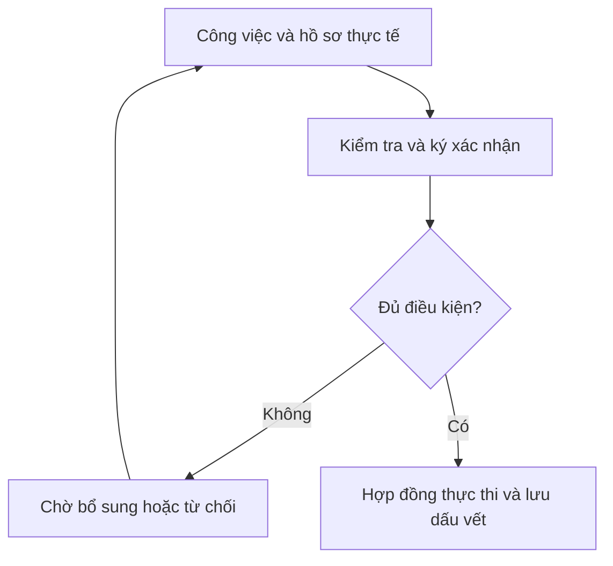

# Propertichain — Roadmap Grand Park v1.1

Ngày cập nhật: 08/11/2026. Kế hoạch đề xuất theo điều kiện nghiệm thu, không phải cam kết ngày triển khai.

## Điểm xuất phát

Ưu tiên căn hộ và shophouse hiện hữu thuộc chủ đầu tư chưa bán hết, đang chào bán, được chủ sở hữu đồng ý và vượt kiểm tra hồ sơ. Grand Park là case nghiên cứu độc lập; chưa có xác nhận hợp tác với Vingroup/Vinhomes, ngân hàng hoặc chủ đầu tư khác. Quỹ căn thực chưa được cung cấp.

Đã có: site công khai Việt–Anh, dữ liệu phân khu có nguồn và walkthrough mô phỏng. Chưa có: hợp đồng testnet, quyền sở hữu token được công nhận, đối tác cam kết, form quan tâm hoặc huy động tiền thật.

## Workflow ba lớp

| Lớp | Thực hiện | Đầu ra |
|---|---|---|
| Thực tế | Chủ sở hữu, chủ đầu tư, ngân hàng, quản lý và thẩm định | Công việc thật và hồ sơ gốc |
| Xác nhận | Bên có thẩm quyền kiểm tra, ký và phê duyệt theo mã căn/phiên bản | Bằng chứng có thời hạn, bên chịu trách nhiệm |
| Hợp đồng | Kiểm tra điều kiện, nguồn cung, quyền chuyển và quỹ tiền | Hành động được phép và nhật ký |

Ghi lên blockchain không tự chứng minh hồ sơ đúng. Giấy tờ riêng tư lưu ngoài blockchain có phân quyền; onchain lưu tham chiếu, dấu xác thực, phiên bản và các xác nhận phù hợp.

## Bộ não vận hành

1. Nếu chưa xác minh hiện hữu, quyền sở hữu, Available và đồng ý của chủ đầu tư: giữ ở hồ sơ ứng viên, không mở phát hành.
2. Nếu nguồn xác nhận sai thẩm quyền, hết hạn, sai mã căn/phiên bản hoặc đã thu hồi: từ chối.
3. Nếu quyền chuyển giao hoặc thanh toán chưa đủ điều kiện: khóa bước phát hành. Không mint chỉ vì người vận hành bấm duyệt.
4. Nếu chưa thu tiền thuê hoặc quỹ chưa đủ: không phân phối phần thiếu; ghi công nợ và kỳ thuê riêng.
5. Nếu giá thiếu bằng chứng hoặc hết hạn: chờ định giá; giá nhà tăng không tự tăng tiền thuê.
6. Nếu có sự cố: chỉ kích hoạt quyền dừng/khóa được cấp, lưu lý do; không tự tịch thu hoặc mở khóa.
7. AI gợi ý, phát hiện thiếu hồ sơ và giải thích; con người xác nhận, hợp đồng thực thi quy tắc. AI không tự ký thay ngân hàng, tạo bảo lãnh hoặc quyết định quyền pháp lý.

Đầu ra quyết định chuẩn: CHỜ BỔ SUNG / TỪ CHỐI / ĐỦ ĐIỀU KIỆN / TẠM DỪNG; kèm lý do, mã căn, bằng chứng, người duyệt và phiên bản quy tắc. Không dùng điểm AI để tự vượt điều kiện bắt buộc.

## Các chặng triển khai

### R0 — Chốt mô hình và bộ quy tắc

Đang thực hiện

Thống nhất một sản phẩm có thể kiểm chứng trước khi triển khai hợp đồng.

- **Lớp thực tế:** Chốt phạm vi căn hộ và shophouse đã hiện hữu. Xác định chủ đầu tư, đơn vị vận hành, bên thẩm định và ngân hàng cần tiếp cận; chưa coi họ là đối tác.
- **Lớp xác nhận:** Bộ hồ sơ mẫu, ma trận thẩm quyền, cơ chế bảo lãnh nếu có và điều kiện chuyển quyền cần được thảo luận với bên chuyên môn.
- **Lớp hợp đồng:** Đặc tả mã căn, nguồn cung, quỹ tiền thuê, phân quyền, đóng băng và danh sách kiểm tra; chưa phát hành token.
- **Đầu ra:** Site song ngữ và walkthrough đã có; quyết định pháp lý, đối tác và hợp đồng thật còn mở.
- **Điều kiện chuyển bước:** Chốt phạm vi MVP, người chịu trách nhiệm từng bước và tiêu chí A01–A11. Xác nhận quy định code chuẩn bị trước hackathon.
- **Thước đo đề xuất:** Có danh sách quyết định đã chốt / chưa chốt; không gắn nhãn đối tác hoặc số căn thật khi chưa có bằng chứng.

### R1 — Quỹ căn chủ đầu tư chưa bán

Ưu tiên tiếp theo

Chọn tài sản hiện hữu thuộc quyền của chủ đầu tư, đang chào bán và có sự đồng ý đưa vào cấu trúc token hóa.

- **Lớp thực tế:** Đề nghị chủ đầu tư cung cấp quỹ căn theo tòa/lô và mã căn. Mục tiêu pilot đề xuất 3–5 căn, gồm căn hộ và shophouse, có thể đang thuê hoặc đang trống.
- **Lớp xác nhận:** Đối soát quyền sở hữu, chưa bán sơ cấp, bàn giao, Available, nghĩa vụ bảo đảm, hợp đồng thuê, giá và thẩm quyền bán. Không suy ra tồn kho từ quảng cáo.
- **Lớp hợp đồng:** Chuẩn hóa registry và mô hình trạng thái bằng dữ liệu giả lập; hồ sơ thật chỉ gắn sau khi được cho phép và xác minh.
- **Đầu ra:** Bộ hồ sơ căn chuẩn, danh sách thiếu chứng từ, đề xuất tỷ lệ bán và phương án vốn. Nếu chưa có đối tác, dùng bộ hồ sơ giả lập và ghi rõ.
- **Điều kiện chuyển bước:** Tài sản hiện hữu; đúng chủ sở hữu; Available; có thẩm quyền và đồng ý; các nghĩa vụ hạn chế phải được xử lý theo cấu trúc đã duyệt.
- **Thước đo đề xuất:** 100% trường bắt buộc được xác minh hoặc ghi rõ thiếu; 0 căn chào bán giả hoặc token hóa trùng trong registry.

### R2 — Chứng minh quy trình trên testnet

Chưa triển khai

Chuyển walkthrough thành hợp đồng kiểm tra được, dùng tài sản và tiền thử nghiệm.

- **Lớp thực tế:** Nhóm sản phẩm và kỹ thuật chuẩn bị ví vai trò, tình huống dữ liệu và kịch bản sự cố.
- **Lớp xác nhận:** Mô phỏng xác nhận nhiều bên có mã căn, phiên bản hồ sơ, loại quyền, thời hạn và người ký; từ chối xác nhận hết hạn hoặc bị thu hồi.
- **Lớp hợp đồng:** Xây registry, token từng căn, vault, bộ điều kiện phát hành và quản trị; thử phân phối đúng căn, chuyển nhượng giữa kỳ, pause/freeze và chống trả trùng.
- **Đầu ra:** Mã nguồn, kết quả kiểm thử, địa chỉ testnet và giao dịch kiểm chứng; không tuyên bố đã kiểm toán nếu chưa có.
- **Điều kiện chuyển bước:** Đạt A01–A11; thêm kiểm tra nguồn xác nhận, hết hạn, phát hành trùng và đường chuyển trực tiếp; rà soát bảo mật trước mở thử rộng.
- **Thước đo đề xuất:** 0 lỗi mất tiền hoặc sai quyền nghiêm trọng còn mở trong phạm vi test; mọi hành động thử nghiệm truy vết được.

### R3 — Tiếp cận và đào tạo retail

Chạy song song R1–R2

Kiểm chứng nhu cầu và mức độ hiểu sản phẩm trước khi mở mua thật.

- **Lớp thực tế:** Dùng website, Binance Square, X, Zalo/Facebook, video và các buổi demo với môi giới/cộng đồng. Giai đoạn này mời trải nghiệm, không nhận tiền đặt mua.
- **Lớp xác nhận:** Nội dung công khai phân biệt quyền sở hữu, phí, định giá, tiền thuê thực thu và thanh khoản. Chỉ ghi nhận liên hệ khi có đồng ý, không gom giấy tờ cá nhân trên blockchain.
- **Lớp hợp đồng:** Người thử nghiệm xem bằng chứng testnet và trải nghiệm quyền sở hữu mô phỏng; không thưởng bằng token nền tảng.
- **Đầu ra:** Bộ nội dung Việt–Anh, kịch bản demo, phễu tiếp cận và báo cáo phỏng vấn. Form quan tâm/analytics cần được xây riêng, hiện chưa có.
- **Điều kiện chuyển bước:** Người dùng hiểu token, dòng tiền và điều kiện thoái vốn; kênh thu hút có chi phí phù hợp. Chưa chuyển sang mua thật nếu R4 chưa đạt.
- **Thước đo đề xuất:** Mục tiêu thử: 20 phỏng vấn và 50 lượt hoàn tất demo; đo tỷ lệ hiểu đúng, chưa tính là nhà đầu tư hoặc doanh thu.

### R4 — Pilot: test, sửa lỗi và cải tiến lặp lại

Có điều kiện, chưa mở

Pilot bao gồm thử nghiệm không tiền thật, rồi thí điểm thật giới hạn khi đủ điều kiện; lặp lại kiểm thử, sửa lỗi và cải tiến trước khi nhân rộng.

- **Lớp thực tế:** Nhóm sản phẩm, kỹ thuật, vận hành và người dùng thử ghi nhận lỗi, phản hồi và chi phí. Bắt đầu bằng dữ liệu/tiền thử; chỉ thử tài sản thật sau khi ký với đúng pháp nhân và xác lập cấu trúc quyền, ngân hàng, quản lý và thẩm định.
- **Lớp xác nhận:** Phân loại mức độ lỗi, chỉ định người xử lý, phê duyệt thay đổi và nghiệm thu từng phiên bản. Với pilot thật, xác nhận từng căn, người tham gia, dòng tiền, điều kiện bảo lãnh nếu có và phương án sự cố.
- **Lớp hợp đồng:** Test → sửa lỗi → cải tiến → kiểm thử hồi quy và bảo mật → test lại. Mỗi bản có phiên bản, kết quả và dấu vết; triển khai thật chỉ sau phê duyệt, có cơ chế dừng và phương án khôi phục đã thử.
- **Đầu ra:** Sổ lỗi và phản hồi, lịch sử phiên bản, bằng chứng kiểm thử và báo cáo đối soát. Giữ cổng mua trên site ở trạng thái mô phỏng cho đến khi được mở hợp lệ.
- **Điều kiện chuyển bước:** Để mở pilot thật: đủ điều kiện pháp lý, đối tác, tài sản, thanh toán và bảo mật. Để thoát pilot: lỗi nghiêm trọng đã đóng, kiểm thử hồi quy đạt, đối soát và hỗ trợ ổn định, nghiệm thu bằng văn bản. Nếu chưa đạt, quay lại vòng sửa và test.
- **Thước đo đề xuất:** Theo dõi lỗi tái phát, tỷ lệ test đạt, sai lệch đối soát, thời gian khôi phục, phản hồi người dùng và chi phí/căn. Với căn đang thuê, mục tiêu đề xuất 3 kỳ thuê liên tiếp đối soát đúng.

### R5 — Nhân rộng trong nội bộ tập đoàn

Sau khi nghiệm thu pilot

Mở rộng theo từng đợt trong tập đoàn chủ đầu tư trước khi bán giải pháp ra ngoài.

- **Lớp thực tế:** Mở từ nhóm căn pilot sang tòa, phân khu hoặc dự án khác trong tập đoàn; đào tạo các đơn vị bán hàng, quản lý và hỗ trợ. Chỉ áp dụng khi có thỏa thuận thực tế.
- **Lớp xác nhận:** Mỗi pháp nhân/dự án có quyền, hồ sơ và nghiệm thu riêng. Đối soát dữ liệu chuyển đổi và phê duyệt từng đợt; dừng mở rộng nếu chất lượng giảm.
- **Lớp hợp đồng:** Tái sử dụng mẫu hợp đồng đã kiểm tra; cô lập token và quỹ từng căn, phân quyền từng dự án; test tải, quyền truy cập và khôi phục ở quy mô lớn hơn.
- **Đầu ra:** Bộ triển khai nội bộ, quy trình đào tạo/hỗ trợ, báo cáo nhiều dự án và kinh tế đơn vị.
- **Điều kiện chuyển bước:** Các đợt nội bộ được nghiệm thu, không còn lỗi nghiêm trọng mở, vận hành và đối soát ổn định; có năng lực phục vụ trước khi mở R6.
- **Thước đo đề xuất:** Thời gian triển khai mỗi dự án, lỗi sau mở rộng, chi phí/căn, chất lượng hỗ trợ và tỷ lệ đối soát đúng.

### R6 — Nhân rộng giải pháp cho chủ đầu tư

Sau khi nhân rộng nội bộ đạt

Bán giải pháp cho chủ đầu tư khác sau khi chứng minh được pilot và khả năng nhân rộng trong nội bộ tập đoàn.

- **Lớp thực tế:** Tiếp cận chủ đầu tư khác bằng báo cáo pilot, đề xuất triển khai, phí năm và mức dịch vụ. Mở tiếp tài sản chủ nhà bán lại; khoản vay và hoán đổi là nhánh nghiên cứu sau.
- **Lớp xác nhận:** Mỗi doanh nghiệp có hợp đồng, vai trò, dữ liệu và quy trình thẩm định riêng; quản lý xung đột lợi ích khi định giá và bán tài sản.
- **Lớp hợp đồng:** Mẫu hợp đồng triển khai lặp lại, cô lập từng tài sản/đối tác, API và nhật ký kiểm chứng; mở rộng mà không giảm kiểm soát.
- **Đầu ra:** Gói triển khai + thuê nền tảng; phí giao dịch/dịch vụ chỉ khi có hợp đồng, tránh tính hai lần cùng công việc.
- **Điều kiện chuyển bước:** R5 đã nghiệm thu; kinh tế đơn vị, khả năng phục vụ và bảo mật có bằng chứng; hợp đồng khách hàng ngoài tập đoàn được ký riêng.
- **Thước đo đề xuất:** Đo doanh thu định kỳ, chi phí phục vụ, biên đóng góp, thời gian triển khai và tỷ lệ giữ khách; mục tiêu hợp đồng thứ hai chưa đạt.

## Kênh tiếp cận nhà đầu tư nhỏ lẻ

| Kênh | Mục tiêu | Nội dung | Đo lường |
|---|---|---|---|
| Website / landing page | Nguồn thông tin trung tâm, hồ sơ tài sản và demo | Quyền lợi, phí, rủi ro, bằng chứng và câu hỏi thường gặp | Tỷ lệ hoàn tất demo và hiểu đúng |
| Binance Square + X | Tiếp cận cộng đồng tài chính và Web3 của Fual | Case từng căn, video quy trình, giải thích giá nhà khác tiền thuê | Lượt truy cập có chất lượng vào site |
| Zalo + Facebook | Khách hàng tài chính và người quan tâm nhà ở | Bài dễ hiểu, buổi hỏi đáp, mời dùng demo có đồng ý | Cuộc trao đổi đủ thông tin và lượt demo |
| Video + livestream | Giải thích sản phẩm trước khi chuyển đổi | Theo dõi một căn từ hồ sơ đến tiền thuê; cả tình huống trống và chậm trả | Mức độ hiểu quyền sở hữu và thanh khoản |
| Chủ đầu tư + môi giới + sự kiện | Kênh phân phối đồng ý hợp tác, không mặc định đã có | Demo mang thương hiệu đối tác, đào tạo và tiếp nhận phản hồi | Chi phí tiếp cận và nhu cầu được xác thực |

Phễu đề xuất: nội dung giáo dục → website → hoàn tất demo → quan tâm có đồng ý → kiểm tra điều kiện tham gia → giao dịch chỉ khi được mở hợp lệ → báo cáo và chăm sóc sau giao dịch. Chưa triển khai tracking, CRM, form hoặc gửi tin tự động trong tài liệu này.

Không hứa lợi nhuận hoặc thanh khoản; không FOMO; không thưởng bằng altcoin dự án. Giai đoạn R3 thu hút người dùng demo, không nhận tiền mua token. Mục tiêu mua từ 1–2 USD cần kiểm chứng chi phí thanh toán, nhận diện và phục vụ; chưa phải mức đầu tư khả dụng.

## Mô hình doanh thu để kiểm chứng

Ưu tiên phí triển khai doanh nghiệp và thuê nền tảng hằng năm. Phí giao dịch thành công, quản trị tài sản hoặc dịch vụ tích hợp chỉ bổ sung theo hợp đồng. Phí bảo lãnh, nếu có, thuộc thỏa thuận với bên bảo lãnh, không mặc định là doanh thu của Propertichain. Không thu hai lần cho một dịch vụ.

Phải tách tiền mua bất động sản, tiền thuê và doanh thu phí. Nếu mua trước phải tính vốn và thời gian tồn kho; nếu bán thay phải xác định đúng bên nhận tiền. Chỉ mở rộng khi doanh thu trừ chi phí phục vụ, hạ tầng, đối soát, hỗ trợ và đối tác tạo biên đóng góp có cơ sở.

## Việc làm ngay

1. Chốt vai trò sản phẩm, kỹ thuật hợp đồng, dữ liệu/đối soát và pháp lý/đối tác; chưa gán người thật khi chưa nhận nhiệm vụ.
2. Soạn checklist và mẫu đề nghị quỹ căn chủ đầu tư; chưa gửi ra ngoài khi chưa được yêu cầu.
3. Chuẩn hóa bộ hồ sơ pilot 3–5 căn giả lập, gồm cả căn thuê và căn trống; không gán mã căn thật.
4. Viết đặc tả xác nhận theo thẩm quyền và bộ kiểm tra A01–A11 cùng thử nghiệm dữ liệu giả/thu hồi/hết hạn.
5. Chuẩn bị nội dung giáo dục và câu hỏi phỏng vấn retail; form quan tâm có đồng ý là hạng mục riêng.

## Tham chiếu nội bộ và ranh giới

Kế thừa Property-RWA-Blueprint-v0.1.md, đặc biệt A01–A11. Roadmap này cập nhật ưu tiên: quỹ căn chủ đầu tư trước, chủ nhà bán lại sau. Phân khu có nguồn không chứng minh tình trạng sở hữu hoặc tồn kho từng căn. Các con số pilot, lượt thử và kỳ thuê ở đây là mục tiêu đề xuất, chưa đạt.

Chưa phát hành token, chưa có giao dịch thật, chưa có tư cách đại diện Vingroup/Vinhomes. Tài liệu là kế hoạch sản phẩm, không phải kết luận pháp lý hoặc thông báo mở bán.

## Trình tự nhân rộng và mua trực tiếp

R4 là vòng lặp test → sửa lỗi → cải tiến → test lại, gồm thử mô phỏng trước và pilot thật khi đủ điều kiện. Chỉ sau nghiệm thu mới R5 nhân rộng nội bộ tập đoàn; sau khi R5 đạt mới R6 bán giải pháp cho chủ đầu tư khác.

Thiết kế mục tiêu mua trên site: chọn căn → đọc hồ sơ/quyền/giá/phí/tiền thuê → kiểm tra điều kiện → ví hoặc thanh toán được hỗ trợ → xác nhận → thanh toán và nhận token đúng căn → quản lý quyền và tiền thuê. Checkout thật, ví và nhận tiền chưa triển khai. Thanh toán thất bại không được ghi nhận mua thành công.
